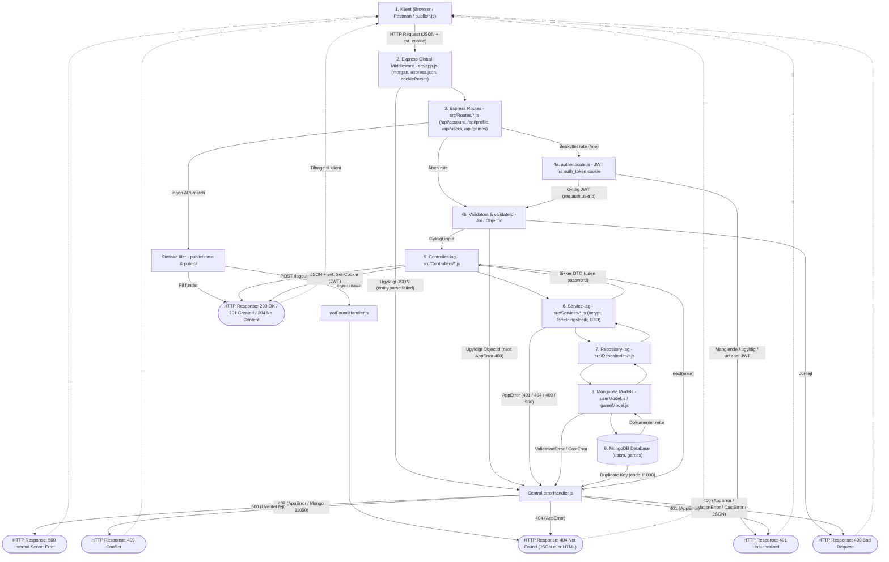

# Arkitektur og mappestruktur
```
project-root/
├── src/
│   ├── config/          # Håndterer database forbindelse
│   ├── controllers/     # Håndterer server respons baseret på ruten
│   ├── middleware/      # Validering af requests
│   ├── models/          # Data objekter og kald til api
│   ├── repositories/    # Håndterer data fra databasen
│   ├── routes/          # Express routes
│   ├── services/        # Håndterer logik og kald til api
│   ├── utils/           # Kontrollerede fejl
│   ├── validators/      # Validering
│   ├── views/           # static 404.html
│   └── app.js           # Konfiguration af express app
├── public/              # Simpel HTML/CSS/fetch
├── tests/               
│   └── api/             # Endpoint test
├── package.json         # Project metadata and dependencies
├── README.md            # Project documentation
├── .env                 # Miljøvariabler (ikke i git)
└── server.js            # Start server
```

# STEP 1: Lav Scrum Board/Issues
- Lav et Scrum board i GitHub Project.
- Lav kolonnerne: Product Backlog, Sprint Backlog, In progress, Review, Done.
- Lav et Issue for hver opgave med acceptkriterier.
- Assign Issues til den specificerede bruger.
- Efter assign skal den valgte Issue rykkes til Sprint Backlog.

# REST-endpoints

| Metode | URL | Formål | Succes |
| --- | --- | --- | --- |
| GET | `/api/users`| Hent alle brugere | 200 OK|
| GET | `/api/users/:id`| Hent specifik bruger | 200 OK |
| POST | `/api/users`| Opret ny bruger | 201 created |
| PUT | `/api/users/:id`| Tildel data til specifik bruger | 200 OK |
| DELETE | `/api/users/:id`| Slet specifik bruger| 200 OK |
| POST | `/api/account/register` | Opret en ny bruger | 201 created |
| POST | `/api/account/register` | Ugyldigt username| 400 bad request |
| POST | `/api/account/register` | Duplikeret email| 409 conflict |
| POST | `/api/account/register` | Ugyldigt password| 400 bad request |
| POST | `/api/account/login` | Bruger kan logge ind | 200 OK  |
| POST | `/api/account/login` | Ugyldigt email| 401 unauthorized |
| POST | `/api/account/login` | Ugyldigt password| 401 unauthorized |
| GET | `/api/account/me` | Tilgå ens account| 200 OK|
| POST | `/api/account/logout` | Log ud af account| 200 OK|
| GET | `/api/account/me` | Login påkrævet| 401 unauthorized |
| PATCH | `/api/profile/me` | Ændre desciption| 200 OK |
| PATCH | `/api/profile/me` | Description for lang | 400 bad request  |


**OBS:** `PUT` er her bevidst brugt til som admin i postman kan tildele data til specifikke bruger. `PATCH` er her brugt til brugeren selv, når logget ind, kan opdater.

### Eksempel i Postman

**POST** `http://localhost:3000/account/register`

```json
{
  "username": "Bobby",
  "email": "Bobby@test.com",
  "password": "abcd1234"
}
```
Resultat: 201 Created
```json
{
    "message": "Bruger oprettet"
}
```
# Ekstern API

# Login og JWT

Lokalt skal `.env` indeholde en `JWT_SECRET` på mindst 32 tegn. Generér en stærk værdi med:

```powershell
node -e "console.log(require('crypto').randomBytes(32).toString('hex'))"
```

Kopiér værdien ind i `.env` som `JWT_SECRET=...`; del eller commit ikke værdien. Serveren starter ikke, hvis nøglen mangler eller er for kort.

`POST /api/account/register` opretter kun brugeren og logger ikke ind. Klienten kan derefter sende brugeren til login. `POST /api/account/login` sætter en `HttpOnly`, `SameSite=Lax` cookie med en JWT, der udløber efter en time. På localhost over HTTP er `Secure` slået fra; den er slået til i produktion. `GET /api/account/me` kræver en gyldig cookie, og `POST /api/account/logout` sletter den.

Logout fjerner cookien fra browseren, men tilbagekalder ikke en allerede udstedt JWT. Den token kan derfor bruges indtil udløb; løsningen bruger ikke refresh tokens eller server-side sessions.

# Automatiseret test


